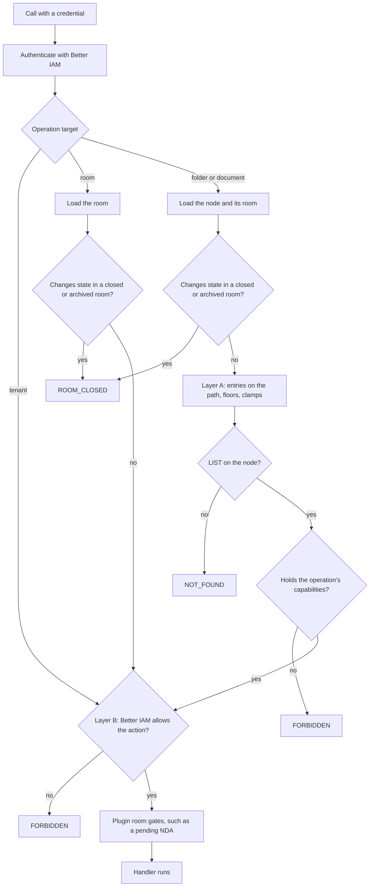

In a deal room the questions are fine-grained. Bidder A may see the financials but not the HR folder. Bidder B may
download watermarked copies, but only the lawyers may take originals. One board pack is view only for everyone. And
someone who must not see a folder should not learn that it exists.

Better Files answers these with a **permission matrix**: for each folder or document, which **capabilities** each
person, group or share link holds there. Every operation also needs a **Better IAM decision** on its action, so your
organization's policies (MFA, working hours, classification rules) apply too.

```ts
// Buyers may view and download watermarked copies everywhere...
await dr.api.permissions.setEntries(credential, {
  tenantId,
  nodeId: room.rootNodeId,
  entries: [{ subject: { type: 'group', id: buyers.id }, preset: 'download' }],
});

// ...but not see the HR folder at all.
await dr.api.permissions.setEntries(credential, {
  tenantId,
  nodeId: hrFolder.id,
  entries: [{ subject: { type: 'group', id: buyers.id }, preset: 'hidden' }],
});
```

## Two layers

Each operation passes both layers, and either can refuse it:

- **Layer A, the permission matrix**, kept by Better Files. It answers "which capabilities does this person hold on
  this node?" from the entries on the node and its ancestors, the room-role floors, and the clamps of room settings,
  document flags and plugins. Node operations name the capabilities they need, such as `DOWNLOAD_ORIGINAL` for
  `documents.requestOriginal`.
- **Layer B, Better IAM**. It answers "may this person perform this action on this resource?", such as
  `better-files:documents:download-original` on the document. The person's relation on the room grants actions through
  the [access model](/docs/guides/better-iam/access-model), and your own Better IAM policies can add conditions or deny.



Room and tenant operations (inviting people, publishing a room) have no node, so only layer B decides them. Every
operation's action, target and capabilities are listed in the [operations reference](/docs/reference/operations).

## Layer A: the permission matrix

### Capabilities

A capability is one thing a subject may do with a node.

| Capability | Lets the holder |
| --- | --- |
| `LIST` | See that the node exists: its name, index number and place in the tree. |
| `VIEW` | Open it in the secure viewer (server-rendered, watermarked pages). |
| `PRINT` | Print from the viewer. |
| `COPY_TEXT` | Copy text from the viewer. |
| `DOWNLOAD_WATERMARKED` | Download a copy stamped for them. |
| `DOWNLOAD_ORIGINAL` | Download the file as uploaded. |
| `UPLOAD` | Add items to a folder, or new versions to a document. |
| `EDIT` | Rename, move, change metadata, restore versions, open earlier versions. |
| `DELETE` | Move to the trash, and restore from it. |
| `MANAGE` | Change permissions and document flags for the subtree. |

Plugins and your configuration can register more capabilities (`capabilities.extensions` in `betterFiles()`, on bits
16 to 30) and more presets (`capabilities.presets`). See the [capabilities reference](/docs/reference/capabilities).

### Presets

A preset is a named set of capabilities. Use a preset or an explicit list in each entry.

| Preset | Capabilities |
| --- | --- |
| `hidden` | none |
| `view` | `LIST` `VIEW` |
| `viewPrint` | `LIST` `VIEW` `PRINT` |
| `download` | `LIST` `VIEW` `PRINT` `DOWNLOAD_WATERMARKED` |
| `downloadOriginal` | `LIST` `VIEW` `PRINT` `COPY_TEXT` `DOWNLOAD_WATERMARKED` `DOWNLOAD_ORIGINAL` |
| `contributor` | `LIST` `VIEW` `PRINT` `DOWNLOAD_WATERMARKED` `UPLOAD` |
| `editor` | `LIST` `VIEW` `PRINT` `DOWNLOAD_WATERMARKED` `UPLOAD` `EDIT` `DELETE` |
| `manager` | every capability, including registered extensions |

### Entries and subjects

An **entry** is one cell of the matrix: a subject, a node (folder or document), and a set of capabilities. A subject
is one of:

- `identity`: one person (or service account), by Better IAM identity id;
- `group`: a [permission group](/docs/guides/concepts/members-and-groups#permission-groups) of the room;
- `link`: a share link, created by the [links plugin](/docs/plugins/links).

A person acts as their identity and as every Better IAM group they belong to.

### How a node's capabilities are resolved

For one person and one node, Better Files walks the path from the room's root folder down to the node:

1. **Per subject, the nearest entry wins.** An entry on a folder applies to everything below it until a deeper entry
   for the same subject replaces it. A deeper entry can **narrow** access (`hidden` on one subfolder) or **widen** it
   (`downloadOriginal` on one document under a `view` folder).
2. **Across subjects, capabilities add up.** A person in two groups holds the union of what each group, and their own
   identity, holds on that node.
3. **Locked entries are final.** When an entry has `locked: true`, deeper entries for the same subject are ignored
   in its whole subtree. The shallowest locked entry on the path wins. Use it to make sure no subfolder grants a
   group more (or less) than you set at the top.
4. **Expired entries are ignored.** An entry with `expiresAt` (epoch milliseconds) stops counting at that time.
5. **Listing requires `LIST` on every ancestor.** If the person cannot list a folder on the path, they hold nothing
   below it, even where a deeper entry grants access. Set the room setting `requireAncestorList: false` to let a
   direct grant reach through hidden folders.

A node without `LIST` does not exist for that person: operations on it fail with `NOT_FOUND`, never `FORBIDDEN`, so a
hidden folder's name and id are not confirmed. A node they can list but not use for the operation fails with
`FORBIDDEN`.

### Room-role floors

Some room relations hold capabilities everywhere, whatever the matrix says:

- people allowed `better-files:admin` on the room (owners and admins in the access model) hold **every** capability on
  every node;
- people allowed `better-files:activity:export` (owners, admins and auditors) hold at least `LIST` and `VIEW` on every
  node.

Floors are added before clamps, so a closed room or a view-only flag still applies to administrators.

### Clamps

After the matrix and floors, **clamps** remove capabilities. Nothing can add them back.

| Source | Removes |
| --- | --- |
| Room `closed`, `archived` (or still provisioning) | `UPLOAD` `EDIT` `DELETE` |
| Room setting `downloadsEnabled: false` | `DOWNLOAD_WATERMARKED` `DOWNLOAD_ORIGINAL` |
| Room setting `printEnabled: false` | `PRINT` |
| Document flag `viewOnly` | `DOWNLOAD_WATERMARKED` `DOWNLOAD_ORIGINAL` `PRINT` `COPY_TEXT` |
| Document flag `noPrint` | `PRINT` |
| Document flag `noCopy` | `COPY_TEXT` |
| Plugin `clampCapabilities` hooks | whatever the plugin returns, such as everything but `LIST` while an [NDA](/docs/plugins/nda) is pending |

### Document flags

Flags make one document stricter for everyone, without touching the matrix:

```ts
await dr.api.documents.setFlags(credential, {
  tenantId,
  nodeId: boardPack.id,
  flags: { viewOnly: true }, // merged with the current flags
});
```

It needs `MANAGE` on the document and returns `{ flags }`. Flags are also given to Better IAM policies as the
document's `viewOnly` attribute.

## A worked example

A room for a sale, with a group `Buyers` and one buyer, Ben, who is a member of it:

```
Index                        Buyers: download
├── 1 Financials             Buyers: view
│   ├── 1.1 revenue.pdf
│   └── 1.2 forecast.xlsx    Ben (identity): downloadOriginal
├── 2 Legal                  Buyers: hidden
│   └── 2.1 Contracts        Buyers: download
└── 3 Teaser.pdf             flag: viewOnly
```

What Ben holds:

| Node | Ben's capabilities | Why |
| --- | --- | --- |
| `1 Financials` | `LIST` `VIEW` | The nearer `view` entry replaces `download` from the root. |
| `1.1 revenue.pdf` | `LIST` `VIEW` | Inherits from `Financials`. |
| `1.2 forecast.xlsx` | `LIST` `VIEW` `PRINT` `COPY_TEXT` `DOWNLOAD_WATERMARKED` `DOWNLOAD_ORIGINAL` | His own entry adds to the group's `view`. |
| `2 Legal` | none: `NOT_FOUND` | `hidden` for Buyers. |
| `2.1 Contracts` | none: `NOT_FOUND` | The entry grants `download`, but he cannot list `Legal` above it. With `requireAncestorList: false` he would hold `download`. |
| `3 Teaser.pdf` | `LIST` `VIEW` | `download` from the root, minus what `viewOnly` removes. |

Ben's index shows `1 Financials`, `1.1`, `1.2` and then `2 Teaser.pdf`: index numbers count only what he can list.

Had the root entry been `locked: true`, the `view`, `hidden` and `download` entries for Buyers below it would be
ignored: Ben would hold `download` on every node, `Legal` and `Contracts` included, except where his own entry adds
more (`forecast.xlsx`) or a flag removes some (`Teaser.pdf` stays view only).

## Layer B: the Better IAM decision

After the matrix allows a node operation (and directly, for room and tenant operations), Better Files asks Better IAM
whether the caller may perform the operation's action on its resource:

- tenant operations (`rooms.create`, `rooms.list`): on the tenant;
- room operations: on `better-files-room/{roomId}`;
- folder and document operations: on `better-files-folder/{id}` or `better-files-document/{id}`, which Better IAM
  resolves to the room through `betterFilesResolver`.

The access model is broad on content actions: every room relation may list, view and download, because the matrix
already decides which folders and documents each person reaches. What layer B adds:

- **A room relation is required.** Someone with a matrix entry but no relation on the room (directly or through a
  group) is refused.
- **Room management follows the relation.** Publishing, inviting, managing members and permissions, closing and
  exporting each need the right relation; see
  [Members and groups](/docs/guides/concepts/members-and-groups#room-relations).
- **Your policies apply.** A Better IAM policy can deny `better-files:documents:download-original` without MFA, outside
  office hours, or for rooms whose `resource.classification` is `restricted`, whatever the matrix grants.

See [Access model](/docs/guides/better-iam/access-model) for the relations, the participant role and policy
attributes.

## Manage entries

### permissions.setEntries

```ts
await dr.api.permissions.setEntries(credential, {
  tenantId,
  nodeId: folder.id,
  entries: [
    { subject: { type: 'group', id: advisers.id }, preset: 'downloadOriginal', locked: true },
    {
      subject: { type: 'identity', id: benId },
      capabilities: ['LIST', 'VIEW', 'PRINT'],
      expiresAt: Date.now() + 7 * 86_400_000,
    },
    { subject: { type: 'group', id: buyers.id }, remove: true },
  ],
});
// { changed: 3 }
```

It needs `MANAGE` on the node and `better-files:permissions:manage` (owners and admins). Each of the 1 to 100 entries
takes:

<TypeTable
  type={{
    subject: {
      type: "{ type: 'group' | 'identity'; id: string }",
      description: 'A permission group of the room (by its Better Files id) or an identity id. An unknown group is NOT_FOUND.',
      required: true,
    },
    preset: { type: 'string', description: 'A preset name. Give a preset or capabilities, not both.' },
    capabilities: {
      type: 'string[]',
      description: 'Up to 32 capability names. Give a preset or capabilities, not both.',
    },
    locked: {
      type: 'boolean',
      description: 'Final for the subtree: deeper entries for the same subject are ignored.',
      default: 'the existing value, or false',
    },
    expiresAt: {
      type: 'number | null',
      description: 'Epoch milliseconds when the entry stops counting; null removes the expiry.',
      default: 'the existing value',
    },
    remove: { type: 'boolean', description: 'Deletes the subject\'s entry on this node; it then inherits again.' },
  }}
/>

A subject has at most one entry per node; setting it again replaces its capabilities. An entry without `preset`,
`capabilities` or `remove`, or with both, is `INVALID_INPUT`.

**Nobody grants more than they hold.** Each granted set must be within what the caller holds on that node, or the
call fails with `FORBIDDEN`. Room administrators hold everything, so this limits only people who manage a subtree
through a `manager` entry.

Changes are recorded as `permissions.changed` in the activity log, emitted as an event, and written to Better IAM's
audit chain. Plugins can refuse a change in a `beforePermissionChange` hook.

### permissions.getMatrix

`permissions.getMatrix({ nodeId })` returns everything that shapes access at or below a node: the `path` from the root,
every entry on the path and in the subtree, the room's groups (with `kind` and `relation`), and the names of every
capability and preset in force. It needs `MANAGE` on the node and `better-files:permissions:read`.

### permissions.explain

`permissions.explain({ nodeId, identityId? })` answers "why does this person have this access?". For each node on the
path it returns the entries that apply to the person and their resolved capabilities at that depth, then the room and
document clamps. For the caller themselves (no `identityId`), it adds `effective`: the final capabilities, floors and
plugin clamps included.

```ts
const why = await dr.api.permissions.explain(credential, { tenantId, nodeId: contracts.id, identityId: benId });
// why.path: [{ nodeId, name, matrix: ['LIST', 'VIEW', ...], entries: [...] }, ...]
// why.clamps: [{ reason: 'downloads are disabled in this room', removes: [...] }]
```

## Check capabilities in your interface

Capabilities are returned with the content, so you rarely need a separate call: `rooms.get`, `rooms.index`,
`folders.list` and `documents.get` include `capabilities` for each node. To ask about specific nodes:

- `permissions.capabilities({ roomId, nodeIds })` (1 to 500 ids) returns `{ [nodeId]: string[] }`, for anyone who may
  list the room;
- on the server, `dr.capabilitiesFor(credential, { tenantId, roomId, nodeIds })` returns the same from layer A only.

In React, `useCapabilities(roomId, nodeIds)` fetches them once for many nodes, and `<Can>` renders its children only
when a capability is held:

```ts
// Many nodes at once: can(nodeId, capability)
const { can, loading } = useCapabilities(roomId, documents.map((d) => d.id));
const showDelete = can(doc.id, 'DELETE');

// One node, declaratively
<Can roomId={roomId} nodeId={doc.id} capability="DOWNLOAD_ORIGINAL" fallback={<DownloadWatermarked />}>
  <DownloadOriginal />
</Can>
```

These are hints for rendering. The server checks both layers on every call, whatever the interface shows.

## Related

- [Members and groups](/docs/guides/concepts/members-and-groups): who holds which relation.
- [Access model](/docs/guides/better-iam/access-model): layer B in detail.
- [Capabilities reference](/docs/reference/capabilities)
- [Operations reference](/docs/reference/operations): each operation's action and capabilities.
- [Links plugin](/docs/plugins/links): share links as matrix subjects.
