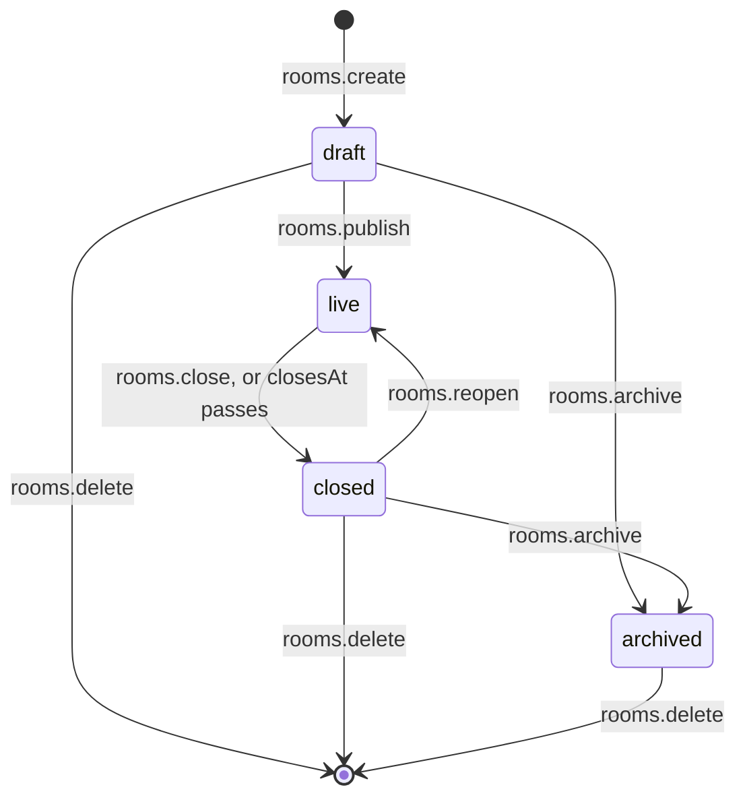

A deal team prepares a room in private, opens it to bidders on a set day, closes it when the deadline passes, and
keeps an archive afterwards. Inside, documents sit in numbered folders ("see 3.2.1"), get replaced by corrected
versions, and are sometimes deleted by mistake and need to come back.

Better Files models this as a **room** with a status, a tree of **nodes** (folders and documents), and **versions**
of each document.

```ts
const room = await dr.api.rooms.create(credential, {
  tenantId,
  name: 'Project Falcon',
  settings: { downloadsEnabled: true, trashRetentionDays: 60 },
  closesAt: Date.parse('2026-12-31T17:00:00Z'), // closed automatically by dr.maintain()
});

const financials = await dr.api.folders.create(credential, {
  tenantId,
  parentId: room.rootNodeId,
  name: 'Financials',
});

await dr.api.rooms.publish(credential, { tenantId, roomId: room.id }); // draft -> live
```

Every endpoint is also on the browser client as `client.<group>.<endpoint>(input)` and over HTTP as
`POST /api/better-files/<group>/<endpoint>`.

## Rooms

### Create a room

`rooms.create` is authorized on the tenant with the action `better-files:rooms:create`. No room relation grants it
(there is no room yet), so give it to the people who may open rooms through a Better IAM role or policy.

<TypeTable
  type={{
    name: { type: 'string', description: '1 to 200 characters, trimmed.', required: true },
    slug: {
      type: 'string',
      description: '2 to 64 lowercase letters, digits and hyphens, starting with a letter or digit; unique in the tenant (CONFLICT when taken).',
      default: 'derived from the name, with a random suffix when taken',
    },
    description: { type: 'string', description: 'Up to 2,000 characters.' },
    settings: { type: 'RoomSettings', description: 'See Room settings below.', default: '{}' },
    closesAt: {
      type: 'number',
      description: 'Epoch milliseconds. When it passes, dr.maintain() closes a live room.',
    },
    region: {
      type: 'string',
      description: 'Where the room\'s files are stored. Needs a regional storage adapter (UNSUPPORTED otherwise); an unknown region is INVALID_INPUT, a region the tenant may not use is FORBIDDEN.',
      default: 'the storage\'s default region',
    },
    fields: {
      type: 'Record of string to JSON',
      description: 'Values for fields you added with schema.rooms.additionalFields.',
    },
  }}
/>

The room is created with a root folder named `Index` (`room.rootNodeId`). Better Files then registers the room in
Better IAM as `better-files-room/{id}`, grants the caller the `owner` relation, adds them to the roster, and creates
the room's encryption key when keys are per room. Until all of that succeeds the room is `provisioning` and invisible;
if any step fails, both sides are undone. The new room comes back as `draft`.

### Read rooms

| Endpoint | Input | Returns |
| --- | --- | --- |
| `rooms.list` | `{ status? }` | Rooms the caller may read (`better-files:rooms:read`), sorted by name, up to 1,000. People with no room role get `[]`, not an error. |
| `rooms.get` | `{ roomId }` | The room, plus `capabilities`: what the caller holds on the root folder. |
| `rooms.index` | `{ roomId }` | Every folder and document the caller may list, flat, in index order, each with `index` and `depth`. |

### Room settings

`settings` is set at creation and changed with `rooms.update`, which merges the keys you send into the current
settings.

<TypeTable
  type={{
    downloadsEnabled: {
      type: 'boolean',
      description: 'false removes DOWNLOAD_WATERMARKED and DOWNLOAD_ORIGINAL from everyone, administrators included.',
      default: 'true',
    },
    printEnabled: { type: 'boolean', description: 'false removes PRINT from everyone.', default: 'true' },
    requireMfaForDownload: {
      type: 'boolean',
      description: 'Downloads and ZIPs need a session signed in with a second factor (MFA_REQUIRED otherwise). Viewing is not affected.',
      default: 'false',
    },
    requireAncestorList: {
      type: 'boolean',
      description: 'A node is reachable only when the caller can LIST every folder above it. false reveals items under hidden folders to people granted them directly.',
      default: 'true',
    },
    trashRetentionDays: {
      type: 'number',
      description: '1 to 3650. How long deleted items stay in the trash before dr.maintain() purges them.',
      default: '30',
    },
    classification: {
      type: 'string',
      description: 'A label for your Better IAM policies (resource.classification), such as confidential. 1 to 64 lowercase letters, digits, underscores or hyphens.',
      default: "'none' as seen by policies",
    },
  }}
/>

The settings Better IAM policies can see (`status`, `classification`, `requireMfa`, `downloadsEnabled`) are copied to
the room's resource in Better IAM when the room is created, when its settings change, and when its status changes.

`rooms.update` takes `{ roomId, name?, description?, settings?, closesAt?, fields? }`. `description: null` and
`closesAt: null` clear them.

### Lifecycle



| Endpoint | From | To | Who (access model) |
| --- | --- | --- | --- |
| `rooms.publish` | `draft` | `live` | owners, admins, publishers |
| `rooms.close` | `live` | `closed` | owners, admins |
| `rooms.reopen` | `closed` | `live` | owners, admins |
| `rooms.archive` | `draft`, `closed` | `archived` | owners, admins |
| `rooms.delete` | anything but `live` | gone | owners |

Each takes `{ roomId }` and returns the room. A transition from any other status is a `CONFLICT`. Each records
`room.published`, `room.closed`, `room.reopened` or `room.archived` in the activity log, emits the same event, and is
written to Better IAM's audit chain.

What the status changes:

- **Draft and live** rooms accept every operation the caller is allowed.
- **Closed and archived** rooms are read-only. Operations that change state fail with `ROOM_CLOSED`, except
  `rooms.reopen`, `rooms.archive` and `rooms.delete`; and `UPLOAD`, `EDIT` and `DELETE` are removed from everyone's
  capabilities, so the interface hides those buttons. Reading, viewing, downloading and exporting still work.
- **Archived** is final: an archived room cannot be reopened, only deleted.

### Scheduled closing

`closesAt` (epoch milliseconds) on `rooms.create` or `rooms.update` schedules the close. `dr.maintain()` closes every
live room whose `closesAt` has passed, exactly as an administrator would, with the actor `system`. Reopening a room
after its scheduled close clears the past `closesAt`, so the next maintenance run does not close it again. Schedule
`dr.maintain()` every few minutes ([Maintenance and jobs](/docs/operations/maintenance-and-jobs)).

### Delete a room

```ts
await dr.api.rooms.delete(credential, { tenantId, roomId, confirmName: 'Project Falcon' });
```

`confirmName` must equal the room's name (`INVALID_INPUT` otherwise), and a live room must be closed first
(`CONFLICT`). A plugin that retains content, such as a legal hold, refuses with `LEGAL_HOLD`. Deletion removes the
room's groups and resource from Better IAM, every row the room owns (plugin tables included), the stored files, and
retires the room's encryption key. It cannot be undone.

### Export a room

`rooms.export` (`{ roomId }`, owners and admins) prepares a ZIP of the room as the caller may take it:

- `manifest.json`: the room, who generated the export and when, every file with its size and SHA-256, the number of
  documents left out, and the activity chain's verification when the log is included;
- `index.csv`: `path,version,size,sha256` for each file;
- `documents/...`: the current version of every document the caller holds `DOWNLOAD_ORIGINAL` on, under its index path
  (`1 Financials/1.2 forecast.xlsx`);
- `activity.jsonl`: the whole activity log, when the caller may perform `better-files:activity:export`.

```ts
const exported = await dr.api.rooms.export(credential, { tenantId, roomId });
// { token, url, expiresAt, files, excluded, bytes }
const response = await dr.files.serve(exported.token); // or GET exported.url
```

Nothing is copied ahead of time: the ZIP is streamed when the ticket is used. The ticket expires after 10 minutes and
works at most twice. Works on closed and archived rooms too.

## The node tree

A room's content is a tree of **nodes**. A node is a folder or a document; every node except the root has a parent
folder. Names are trimmed, 1 to 255 characters, without slashes or control characters, not `.` or `..`, and unique
among their siblings ignoring case (`CONFLICT` otherwise).

| Endpoint | Input | Capability | Does |
| --- | --- | --- | --- |
| `folders.create` | `{ parentId, name }` | `UPLOAD` on the parent | Adds a folder at the end of the parent. |
| `folders.list` | `{ nodeId }` | `LIST` | Returns `{ folder, items }`: the folder and the children the caller may list. |
| `documents.get` | `{ nodeId }` | `LIST` | The document with its capabilities, flags and `currentVersion`. |
| `folders.rename`, `documents.rename` | `{ nodeId, name }` | `EDIT` | Renames. The root folder cannot be renamed. |
| `folders.move`, `documents.move` | `{ nodeId, destinationId }` | `EDIT`, plus `UPLOAD` on the destination | Moves the node and everything under it to the end of another folder of the same room. |
| `folders.delete`, `documents.delete` | `{ nodeId }` | `DELETE` | Moves the node and its subtree to the trash; returns `{ deleted }`, the number of items. |
| `folders.restore`, `documents.restore` | `{ nodeId }` | `DELETE` | Brings back what one deletion trashed; returns `{ restored }`. |
| `rooms.trash` | `{ roomId }` | `DELETE` on each item | The deleted items the caller could restore, newest first. |
| `documents.setFlags` | `{ nodeId, flags }` | `MANAGE` | Sets `viewOnly`, `noPrint`, `noCopy` (see [Permissions](/docs/guides/concepts/permissions#document-flags)). |

Documents are created by uploading a file into a folder: `uploads.create` with a `parentId`, the bytes, then
`uploads.complete`. The browser client does all three in `client.upload({ parentId, file })`. See
[Uploads and downloads](/docs/guides/concepts/uploads-and-downloads).

### Index numbers

Data room indexes are printed with numbers such as `1.2.3`: the third item in the second folder of the first folder.
`rooms.index` numbers the tree depth first. Siblings are ordered by when they were added or moved in, then by name.

Numbers count only the items the caller can list. Someone who cannot see folder 2 sees the next folder as 2, so index
numbers can differ between people; use node ids, not index numbers, to refer to items in code. An item inside a folder
the caller cannot list does not appear in the index at all.

### Move

A move is refused when:

- the destination is not a folder of the same room, or is inside the node being moved (`INVALID_INPUT`);
- the caller cannot list the destination (`NOT_FOUND`) or lacks `UPLOAD` there (`FORBIDDEN`);
- an item with the same name is already there (`CONFLICT`);
- it would take content out from under a legal hold or retention rule (`LEGAL_HOLD`).

Permission entries stay on the nodes they were set on, so a moved node inherits from its new ancestors.

### Trash, restore and purge

Deleting a node marks it and its whole subtree as deleted; nothing is removed yet. Items in the trash disappear from
listings and cannot be opened or downloaded. A plugin that retains content, such as a legal hold, refuses the deletion
with `LEGAL_HOLD`.

To restore, call `restore` on the item that was deleted (the top of the deleted subtree): it brings back everything
that deletion trashed. Items deleted on their own earlier stay in the trash. Restoring is refused when:

- the item was trashed together with a folder above it: restore that folder (`INVALID_INPUT`);
- its parent folder is itself in the trash: restore the parent first (`INVALID_INPUT`);
- another item now has its name in the folder (`CONFLICT`).

`documents.restore` also restores folders, for interfaces that work from the `rooms.trash` list, which mixes both.

`dr.maintain()` purges items that have been in the trash longer than the room's `trashRetentionDays` (30 by default):
their versions, stored files, renditions and permission entries are deleted for good. Content a plugin retains stays in
the trash until it is released.

## Versions

A document's content lives in versions, numbered 1, 2, 3 in upload order. One version is current: it is what people
view and download unless they ask for another.

**Upload a new version** by starting an upload with the document's id instead of a folder:

```ts
// In the browser
await client.upload({ documentId, file, comment: 'Corrected Q3 figures' });

// On the server
const session = await dr.api.uploads.create(credential, {
  tenantId,
  documentId,
  filename: 'forecast.xlsx',
  size: bytes.byteLength,
  comment: 'Corrected Q3 figures',
});
await dr.files.upload(credential, { tenantId, uploadId: session.uploadId, body: bytes });
const { version } = await dr.api.uploads.complete(credential, { tenantId, uploadId: session.uploadId });
```

It needs `UPLOAD` on the document, and the new version becomes current. It is recorded as `version.created`.

| Endpoint | Input | Capability | Does |
| --- | --- | --- | --- |
| `versions.list` | `{ nodeId }` | `VIEW` | Versions, newest first. Callers without `EDIT` see only the current one. |
| `versions.restore` | `{ nodeId, versionId }` | `EDIT` | Makes an earlier version current again, without creating a new number. |

Each version records its `number`, `filename`, `mimeType`, `size`, `sha256`, `uploadedBy`, `comment` and `status`.
Only `ready` versions can be restored (`NOT_FOUND` otherwise) or opened: asking for a version a scanning plugin
holds back as `quarantined` or `processing` is refused with `QUARANTINED`.

Earlier versions are for people who may edit the document. Asking for an older version's file with `versionId` (on
`documents.requestView`, `requestDownload` or `requestOriginal`) needs `EDIT`, so replacing a version with a redacted
one does not leave the old content to everyone who can read the current one.

## Related

- [Permissions](/docs/guides/concepts/permissions): who may do each of these operations.
- [Uploads and downloads](/docs/guides/concepts/uploads-and-downloads): upload sessions, tickets and ZIPs.
- [Activity log](/docs/guides/concepts/activity-log): what each operation records.
- [Maintenance and jobs](/docs/operations/maintenance-and-jobs): scheduling `dr.maintain()`.
- [Operations reference](/docs/reference/operations)
