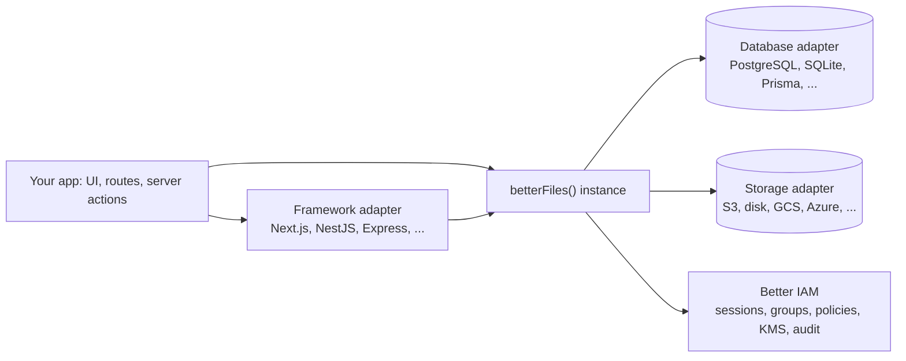

Some products need a place where a company shares sensitive files with a controlled set of people: buyers in an
M&A deal, investors in a fundraising round, directors in a board portal, clients in a client portal. That place is a
**data room**. Building one means folders and versions, a per-folder permission matrix, outside guests, NDAs,
watermarks, an audit trail that holds up later, and encryption at rest.

Better Files is that engine as a library. You install it, call `betterFiles({...})` with your database and storage,
and mount it into your own app. It is not a hosted service: there is no dashboard to deploy and no admin console.
Your app is the product, and Better Files runs inside it. [Better IAM](https://better-iam.com) handles identity and
authorization.

```ts
import { betterFiles } from 'better-files';
import { betterIamIntegration } from 'better-files/iam';
import { postgresAdapter } from 'better-files/adapter-postgres';
import { s3Storage } from 'better-files/storage-s3';

export const dr = betterFiles({
  iam: betterIamIntegration(iam, { iamPlugin, systemCredential }),
  database: postgresAdapter({ pool }),
  storage: s3Storage({ bucket: 'rooms', region: 'eu-west-1' }),
  secret: process.env.BETTER_FILES_SECRET!,
});

const room = await dr.api.rooms.create(credential, { tenantId, name: 'Project Falcon' });
```

## What you get

The core covers rooms, folders, documents, versions, uploads, members, permission groups, the permission matrix and
the activity log. Everything else is a plugin you add when you need it.

- **Rooms, folders and versions**: a numbered index, trash, room lifecycle (publish, close, archive) and room
  exports. See [rooms and content](/docs/guides/concepts/rooms-and-content).
- **The permission matrix**: capabilities such as `VIEW`, `DOWNLOAD_WATERMARKED` and `DOWNLOAD_ORIGINAL` per group
  or person, per folder, inherited down the tree. See [permissions](/docs/guides/concepts/permissions).
- **Guests**: people from outside the organization, invited into a room. See
  [outsiders](/docs/guides/better-iam/outsiders).
- **[NDA gating](/docs/plugins/nda)**, **[watermarking](/docs/plugins/watermark)** and
  **[share links](/docs/plugins/links)**.
- **[Q&A](/docs/plugins/qa)**, **[search](/docs/plugins/search)** and **[e-signature](/docs/plugins/esign)**.
- **[Legal holds](/docs/plugins/retention)**, **[webhooks](/docs/plugins/webhooks)** and
  **[sync](/docs/plugins/sync)** for desktop and command-line mirrors.
- **[Permission-aware AI and MCP](/docs/plugins/ai)**: questions and summaries grounded only in documents the asker
  may view, and MCP tools that run as the signed-in user.
- **A hash-chained activity log**: every entry is linked to the previous one, so `dr.verifyActivity()` detects
  edits. See [activity log](/docs/guides/concepts/activity-log).

Files are encrypted at rest, and downloads go through short-lived signed tickets.

## How it fits your app



- **Your app** calls `dr.api.*` from its own routes and server code, and the browser talks to the mounted protocol
  through the typed client and hooks.
- **A framework adapter** mounts the protocol (by default under `/api/better-files`). See
  [frameworks](/docs/frameworks).
- **The database adapter** holds the Better Files tables, which can live in your app's database.
- **The storage adapter** holds the encrypted file contents.
- **Better IAM** says who is calling and whether they may act, and keeps room roles, groups, encryption keys and the
  security audit chain.

## Two layers of access

Every folder and document operation passes two checks, and either can refuse it. The first is the **permission
matrix** in Better Files: each group or person gets a capability mask on a folder or document, inherited down the
tree, and room settings, document flags and plugins (a pending NDA, a quarantined file) can then remove bits. A node
the caller cannot list is reported as not found. The second is a **Better IAM decision** on the Better Files action
for that resource (for example `better-files:documents:download`), where MFA, network rules and your own policies
apply. See [the access model](/docs/guides/better-iam/access-model).

## Where to go next

<Cards>
  <Card title="Quickstart" href="/docs/guides/quickstart" icon="Rocket">
    A working room in one file, with in-memory adapters and no services.
  </Card>
  <Card title="Installation" href="/docs/guides/installation" icon="Package">
    Better IAM, a real database, storage, encryption and every option.
  </Card>
  <Card title="Concepts" href="/docs/guides/concepts" icon="Library">
    Rooms, permissions, members, uploads, the activity log and events.
  </Card>
  <Card title="Better IAM integration" href="/docs/guides/better-iam" icon="ShieldCheck">
    Sign-in, policies, outsiders, per-room keys and the audit chain.
  </Card>
  <Card title="Frameworks" href="/docs/frameworks" icon="Blocks">
    Mount the protocol in Next.js, NestJS, Express and others; React, Vue and Svelte clients.
  </Card>
  <Card title="Plugins" href="/docs/plugins" icon="Puzzle">
    NDA, watermarking, share links, Q&A, search, e-signature, AI and more.
  </Card>
  <Card title="Operations" href="/docs/operations" icon="Server">
    Databases, storage, encryption, maintenance jobs, deployment and the CLI.
  </Card>
</Cards>

## Related

- [FAQ](/docs/guides/faq)
- [Packages](/docs/reference/packages)
