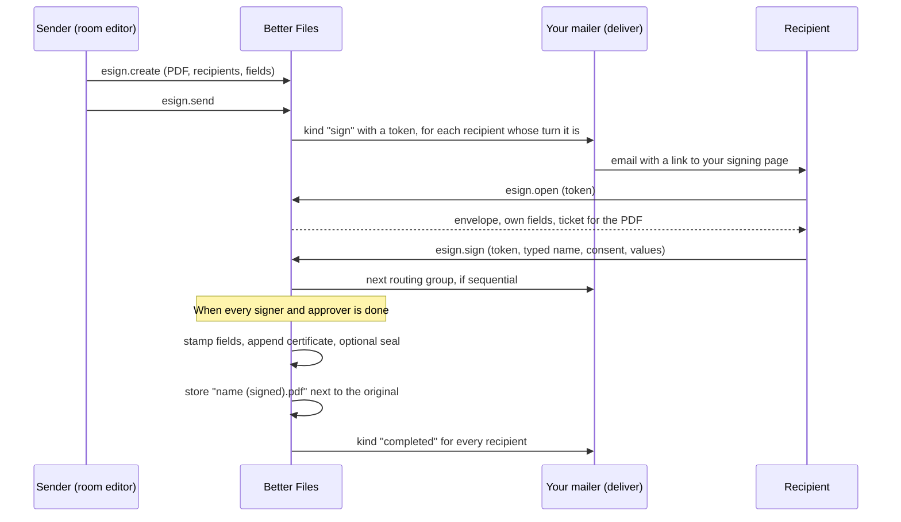

At the end of a deal, the share purchase agreement sitting in the data room has to be signed by several people,
sometimes in a fixed order. Downloading it, sending it through a separate signing service, and uploading the signed
copy again breaks the room's record of what happened to the document.

The e-signature plugin keeps the whole process in the room. You prepare an **envelope** (one PDF, its recipients and
the fields each one fills in), send it, and the signed copy comes back next to the original. Signing runs either
**natively**, through links your app emails to recipients, or at **DocuSign** or **Dropbox Sign**. Either way the
plugin keeps a hash-chained **evidence trail** of each step.

```ts
import { betterFiles } from 'better-files';
import { betterFilesIamPlugin } from 'better-files/iam';
import { esignPlugin } from 'better-files/plugin-esign';

const plugins = [
  esignPlugin({
    // Your mailer: put delivery.token in a link to your signing page.
    deliver: async (delivery) => mailer.send(delivery),
  }),
] as const;

const iamPlugin = betterFilesIamPlugin({ plugins }); // registers better-files:esign:send and better-files:esign:sign
export const dr = betterFiles({ /* iam, database, storage, secret */ plugins });
```

The plugin owns four tables: `envelopes`, `envelopeRecipients`, `envelopeFields` and `envelopeEvents`. On a SQL
database, run `better-files generate` and `better-files migrate` after adding it.

<Callout type="info" title="About legal effect">
  The plugin records what happened: who was sent a link, who opened it, the name they typed, their consent, the time,
  and the client IP address and user agent when the server knows them. Whether that is enough for a given document
  and jurisdiction is a legal question this library does not answer. Ask your counsel which signature types your
  documents need.
</Callout>

## Options

`esignPlugin()` needs `deliver`, a `provider`, or both; with neither it throws `INVALID_CONFIG`.

<TypeTable
  type={{
    deliver: {
      type: '(delivery: Delivery) => Promise<void>',
      description: 'Sends signing links and notices. Required for native signing. With a provider, it only receives the completed notices.',
    },
    linkDays: { type: 'number', description: 'Days a signing link stays valid.', default: '30' },
    provider: {
      type: 'EsignProvider',
      description: 'Run signing at an external service (docusignProvider, dropboxSignProvider) instead of natively.',
    },
    syncIntervalMs: {
      type: 'number',
      description: 'Minimum time between two provider reads of one envelope through esign.sync calls that do not carry the provider id.',
      default: '5000',
    },
    seal: {
      type: 'PdfSealer',
      description: 'Seal natively signed PDFs with a PAdES signature (keySealer, or selfSignedSealer in development).',
    },
    sealLocation: { type: 'string', description: "The seal's location field, for example your company's city." },
  }}
/>

## The signing flow



### 1. Create an envelope

`esign.create` prepares a draft envelope over the document's current version. The document must be a PDF whose
version is ready (`INVALID_INPUT` "Only PDF documents can be signed", or `CONFLICT` when there is no signable version).

```ts
const envelope = await dr.api.esign.create(credential, {
  tenantId,
  nodeId: documentId,
  title: 'SPA signature',
  routing: 'sequential',
  recipients: [
    { email: 'seller@target.example', name: 'Sam Seller' },
    { email: 'buyer@acquirer.example', name: 'Bea Buyer' },
    { email: 'counsel@law.example', name: 'Counsel', role: 'cc' },
  ],
  fields: [
    { recipient: 0, type: 'signature', page: 2, x: 50, y: 600, width: 200, height: 40 },
    { recipient: 0, type: 'date', page: 2, x: 300, y: 600, width: 120, height: 20 },
    { recipient: 1, type: 'signature', page: 2, x: 50, y: 500, width: 200, height: 40 },
    { recipient: 1, type: 'text', page: 2, x: 300, y: 500, width: 200, height: 20 },
  ],
});
```

<TypeTable
  type={{
    nodeId: { type: 'string', description: 'The document to sign.', required: true },
    title: { type: 'string', description: 'Up to 200 characters.', default: 'the document name' },
    message: { type: 'string', description: 'Up to 2000 characters, passed to deliver and providers.' },
    routing: {
      type: "'parallel' | 'sequential'",
      description: 'parallel invites everyone at once; sequential invites the lowest order not yet done, then the next.',
      default: "'parallel'",
    },
    recipients: {
      type: '{ email; name; role?; order? }[]',
      description: '1 to 50. role is signer (default), approver or cc. order (1 to 100) defaults to the position in the list; equal orders form one routing group.',
      required: true,
    },
    fields: {
      type: '{ recipient; type; page; x; y; width; height; required? }[]',
      description: 'Up to 500. recipient is an index into recipients. type is signature, initials, date, text or checkbox. required defaults to true, except for checkboxes.',
      required: true,
    },
  }}
/>

Field positions are PDF points measured from the **bottom-left** corner of the page, with `page` starting at 1.
Width and height are 4 to 2000 points. Fields that fall outside the page, point at a missing recipient, or belong to a
`cc` recipient are refused with `INVALID_INPUT`, and an envelope needs at least one signer or approver.

Recipient roles:

- **signer** fills in their fields and signs.
- **approver** goes through the same step, recorded as `recipient.approved` instead of `recipient.signed`.
- **cc** has no fields and no signing link, and receives the completion notice.

The envelope records the SHA-256 of the original version (`originalSha256`). Later uploads to the document do not
change what is signed: the envelope stays on the version it was created over.

### 2. Send

`esign.send({ envelopeId })` moves a draft to `sent`. Natively, it creates a signing token for each recipient whose
turn it is and calls `deliver` with `kind: 'sign'`. A second send of the same envelope is a `CONFLICT`.

`deliver` receives a `Delivery`:

<TypeTable
  type={{
    kind: {
      type: "'sign' | 'completed' | 'reminder' | 'voided'",
      description: 'What the email is about. voided is part of the type, but the plugin does not currently send it.',
    },
    tenantId: { type: 'string', description: 'Put it in the signing link too: the public calls need it.' },
    envelopeId: { type: 'string', description: 'The envelope.' },
    title: { type: 'string', description: 'The envelope title.' },
    message: { type: 'string', description: "The sender's message, when there is one." },
    recipient: { type: '{ email; name; role }', description: 'Who to email.' },
    token: {
      type: 'string',
      description: 'For sign and reminder: the signing token for the link. Treat it like a password and never log it.',
    },
  }}
/>

```ts
esignPlugin({
  deliver: async ({ kind, recipient, token, tenantId, title }) => {
    if (kind === 'sign' || kind === 'reminder')
      await mailer.send({
        to: recipient.email,
        subject: `Please sign: ${title}`,
        text: `https://app.example.com/sign?tenant=${tenantId}&token=${token}`,
      });
    if (kind === 'completed')
      await mailer.send({ to: recipient.email, subject: `Completed: ${title}`, text: 'All parties have signed.' });
  },
});
```

Tokens are 24 random bytes. Only their SHA-256 hash is stored, and they expire after `linkDays`.

### 3. Your signing page

The recipient needs no account. Your signing page calls three public operations with the token. They need no
credential: on the server pass `{}`, in the browser the [typed client](/docs/frameworks/client) works signed out.

```ts
const view = await files.esign.open({ tenantId, token });
// { envelope: { id, title, message?, routing }, recipient: { name, email, role, status },
//   yourTurn, fields, document: { url, token, expiresAt } }

await files.esign.sign({
  tenantId,
  token,
  signatureName: 'Bea Buyer',
  consent: true,
  values: { [textFieldId]: 'Acquirer Holdings Ltd', [checkboxFieldId]: 'true' },
});
// { status: 'signed' } or { status: 'completed', signedDocumentId }

await files.esign.decline({ tenantId, token, reason: 'Wrong entity name' });
```

- `open` marks the recipient `viewed` the first time and records `recipient.viewed`. It returns only that recipient's
  fields, whether it is their turn, and an inline download ticket for the original PDF, issued to the recipient.
- `sign` needs `consent: true` and a typed `signatureName` (1 to 200 characters). Signature fields get the typed
  name, initials fields the first letter of each word, date fields today's date (`YYYY-MM-DD`). Text and checkbox
  values come from `values`, keyed by field id; a checkbox is checked when its value is `'true'`. A missing required
  value is `INVALID_INPUT` "Complete every required field", with the field id in the details. Signing out of turn is
  `CONFLICT` "Other recipients sign first; you will be notified".
- After signing, the token stops working. In sequential routing, finishing a group sends `sign` deliveries to the
  next one.
- `decline` (reason 1 to 1000 characters) marks the recipient and the whole envelope `declined`. Other recipients'
  links then answer `CONFLICT`.

An unknown, used or expired token is `NOT_FOUND` "Signing link". A link for an envelope that is no longer `sent` is
`CONFLICT` "The envelope is …".

### 4. Completion

When no signer or approver is left, the plugin:

1. Appends `envelope.completed` to the evidence trail.
2. Draws each field value on the original PDF (signatures and initials in an italic font, a line under signatures, an
   X in checked boxes).
3. Appends a **certificate of completion** page: envelope id, title, document name, the original's SHA-256, the
   completion time, each recipient with role, status, time, IP address when known and method
   ("emailed signing link"), every evidence event, and the evidence chain head.
4. Seals the file when `seal` is set (below).
5. Stores it in the original's folder as `{name} (signed).pdf`, as a new document recorded as the envelope's creator.
6. Marks the envelope `completed` with `finalSha256` and `signedDocumentId`, sends `completed` deliveries to every
   recipient including `cc`, logs `esign.completed` in the room's activity and emits `esign.completed`.

## The evidence trail

Every step appends an event to the envelope's own chain in `envelopeEvents`: a sequence number, type, actor, time,
IP address and user agent when known, details, the previous event's hash, and its own hash (SHA-256 over a canonical
JSON form of the rest). Changing, removing or reordering an event breaks the chain.

| Event | Actor | Details |
| --- | --- | --- |
| `envelope.created` | the sender | `originalSha256` |
| `envelope.sent` | the sender | `provider`, `externalId` for provider envelopes |
| `recipient.notified`, `recipient.reminded` | `system` (native) or the sender (provider reminders) | `email` |
| `recipient.viewed` | the recipient's email | |
| `recipient.signed`, `recipient.approved` | the recipient's email | `signatureName`, `consent` (native); `provider`, `at` (provider) |
| `recipient.declined` | the recipient's email | `reason` |
| `envelope.completed` | `system` or the provider id | `signedSha256`, `certificateSha256` (provider) |
| `envelope.voided`, `envelope.declined` | the sender or the provider id | `reason` |

`esign.get({ envelopeId })` returns the envelope with its recipients, fields, `events`, and `verification`: the result
of re-checking the chain, `{ valid, events, head? }` or `{ valid: false, events, brokenAt }`. The exported
`verifyEvidence(context, tenantId, envelopeId)` runs the same check in your own code.

The client IP address is known when your framework adapter passes it or when `trustProxy` is set on `betterFiles()`
and the request carries `X-Forwarded-For`.

### Sealing the signed PDF

With `seal`, the signed PDF gets an invisible PAdES signature (baseline B-B): a detached CMS signature over the whole
file, so any later change shows in PDF readers and in `verifyPdfSeal`. Provider-signed PDFs keep the provider's own
seal and are not sealed again.

```ts
import { esignPlugin, keySealer, selfSignedSealer, verifyPdfSeal } from 'better-files/plugin-esign';

esignPlugin({
  deliver,
  seal: keySealer({ privateKey: process.env.SEAL_KEY_PEM!, certificates: process.env.SEAL_CHAIN_PEM! }),
  sealLocation: 'London',
});

// Development only: a fresh P-256 key with a self-signed certificate.
esignPlugin({ deliver, seal: selfSignedSealer({ organization: 'Acme' }) });

const [latest] = verifyPdfSeal(signedBytes);
// { valid, coversWholeDocument, signer?, certificate?, reason? }
```

- `keySealer({ privateKey, certificates })` takes an RSA or EC key (PEM or `KeyObject`) and the PEM chain, signer
  first, and refuses a key that does not match the certificate (`INVALID_CONFIG`).
- `selfSignedSealer({ commonName?, organization?, days? })` is for development: readers show the signature as valid
  but from an unknown identity. For readers to trust a seal, use a certificate from a CA they trust.
- A `PdfSealer` is `{ keyType, certificates(), sign(data) }`, so the key can stay in a KMS or HSM.
- `verifyPdfSeal` checks each seal's digest, signature and certificate binding. It does not decide whether to trust
  the certificate: compare `certificate` with the CAs you trust.
- `sealPdf(bytes, sealer, options)` is exported for sealing other PDFs.

## DocuSign and Dropbox Sign

With a `provider`, you still create envelopes in Better Files, with fields in the same bottom-left coordinates (they
are converted to the provider's top-left coordinates on send). `esign.send` hands the PDF, recipients and fields to
the provider, which emails the recipients and runs the signing. No native links are sent.

```ts
import {
  docusignJwtAuth,
  docusignProvider,
  dropboxSignProvider,
  esignPlugin,
  esignWebhook,
} from 'better-files/plugin-esign';

const provider = docusignProvider({
  basePath: 'https://demo.docusign.net/restapi',
  accountId: process.env.DOCUSIGN_ACCOUNT_ID!,
  accessToken: docusignJwtAuth({ integrationKey, userId, privateKey }),
  connectKeys: [process.env.DOCUSIGN_CONNECT_HMAC_KEY!],
});
// or: dropboxSignProvider({ apiKey: process.env.DROPBOX_SIGN_API_KEY! })

const plugins = [esignPlugin({ provider, deliver: sendCompletionNotice })] as const;
export const dr = betterFiles({ /* … */ plugins });
```

### Mount the webhook

Providers report changes to a URL in your app. `esignWebhook(dr, provider, { onError? })` returns a fetch handler:

```ts title="app/api/esign/webhook/route.ts"
import { esignWebhook } from 'better-files/plugin-esign';
import { dr, provider } from '@/server/better-files';

const webhook = esignWebhook(dr, provider, { onError: (error) => console.error(error) });
export const POST = (request: Request) => webhook(request);
```

It verifies the provider's signature (401 when it does not match, 400 for a malformed body), then calls
`esign.sync` once per envelope named in the message. It answers 500 when a sync failed, so the provider retries, and
ignores envelopes this app does not know.

`esign.sync` never applies the webhook's contents. It reads the envelope's state from the provider's API and applies
that:

- Recipient progress becomes evidence (`recipient.viewed` is recorded too when the provider skipped straight to
  signed), and `esign.signed` is emitted.
- On completion, the provider's signed PDF is stored as `{name} (signed).pdf`, and a separate certificate of
  completion, when the provider has one, as `{name} (certificate).pdf`.
- Declines and voids at the provider are recorded and emitted.

Concurrent syncs, such as a burst of webhooks, complete an envelope once. A failed download sets the envelope back to
`sent` so the next sync retries. Without a webhook, call `esign.sync` yourself:

```ts
await dr.api.esign.sync({}, { tenantId, envelopeId });
```

`esign.sync` is public. Calls without the provider's `externalId` are throttled to one provider read per envelope per
`syncIntervalMs`; a wrong `externalId` is `NOT_FOUND`.

`esign.void` and `esign.remind` act at the provider for provider envelopes, and need the same provider configured
(`INVALID_CONFIG` otherwise).

### DocuSign

<TypeTable
  type={{
    basePath: { type: 'string', description: "The account's API base, such as https://demo.docusign.net/restapi.", required: true },
    accountId: { type: 'string', description: 'The DocuSign account id.', required: true },
    accessToken: { type: '() => Promise<string>', description: 'A current OAuth access token; docusignJwtAuth() obtains and refreshes one.', required: true },
    connectKeys: { type: 'readonly string[]', description: 'Connect HMAC keys. At least one, or the factory throws INVALID_CONFIG.', required: true },
    webhookUrl: { type: 'string', description: 'Sent per envelope as eventNotification, when you do not use an account-level Connect configuration.' },
    fetch: { type: 'FetchLike', description: 'A custom fetch.' },
  }}
/>

- **Access tokens.** `docusignJwtAuth({ integrationKey, userId, privateKey, oauthHost?, fetch? })` uses the JWT grant
  with the `signature impersonation` scope, caches the token and refreshes it a minute before it expires. `oauthHost`
  is `account-d.docusign.com` (demo, the default) or `account.docusign.com`. The API user must have granted consent
  to the integration once.
- **Connect.** Configure Connect to send JSON (SIM) messages with HMAC on, "Include Envelope Custom Fields" and
  "Include Recipients", or set `webhookUrl`. Signatures are read from the `X-DocuSign-Signature-1` (and following)
  headers.
- **Roles.** Approvers become certified-delivery recipients (they open and acknowledge). Routing orders follow the
  envelope's routing.
- **Reminders** resend to every recipient whose turn it is.
- **Completion** downloads the combined signed PDF and DocuSign's certificate of completion.

### Dropbox Sign

<TypeTable
  type={{
    apiKey: { type: 'string', description: 'Authenticates API calls and signs callbacks (event_hash).', required: true },
    testMode: { type: 'boolean', description: 'Send requests in test mode.', default: 'false' },
    clientId: { type: 'string', description: "Sent as the request's client_id, for API apps with their own callback URL and branding." },
    baseUrl: { type: 'string', description: 'The API base.', default: "'https://api.hellosign.com/v3'" },
    fetch: { type: 'FetchLike', description: 'A custom fetch.' },
  }}
/>

- **Callbacks.** Set the account or API app callback URL to your webhook route. The handler answers
  `Hello API Event Received`, which Dropbox Sign expects.
- **Roles.** Dropbox Sign has no approver role, so approvers sign as signers. `cc` recipients become
  `cc_email_addresses`.
- **Completion** downloads the PDF with Dropbox Sign's audit trail appended; there is no separate certificate file.
- A canceled request (HTTP 410 from the API) is treated as voided.

### Other providers

Implement `EsignProvider`: `id`, `send`, `status`, `void`, `remind`, `download` and `parseWebhook`. `send` receives a
`ProviderEnvelope` whose fields use `top` (distance from the top of the page) instead of `y`, and should attach the
Better Files `tenantId` and `envelopeId` as metadata so `parseWebhook` can return them.

## Managing envelopes

| Endpoint | Input | Permission |
| --- | --- | --- |
| `esign.create` | see above | `better-files:esign:send` and `VIEW` on the document |
| `esign.send` | `envelopeId` | `better-files:esign:send` on the room |
| `esign.list` | `roomId`, `status?` | `better-files:esign:send` on the room (also when closed) |
| `esign.get` | `envelopeId` | `better-files:esign:send` on the room (also when closed) |
| `esign.void` | `envelopeId`, `reason` | `better-files:esign:send` on the room (also when closed); the creator or `better-files:admin` |
| `esign.remind` | `envelopeId` | `better-files:esign:send` on the room |
| `esign.sync` | `envelopeId`, `externalId?` | public |
| `esign.open`, `esign.sign`, `esign.decline` | `token`, … | public, by signing token |

`better-files:esign:send` is granted to the room relations `owner`, `admin`, `publisher` and `editor`.

- `list` returns envelopes newest first, with recipients (signing token hashes are never returned).
- `void` (reason 1 to 500 characters) works on `draft` and `sent` envelopes, withdraws a provider envelope at the
  provider first, and stops every outstanding link at once. It records `envelope.voided` and emits `esign.voided`.
- `remind` works on `sent` envelopes. Natively it issues **new** tokens to the recipients whose turn it is and sends
  `reminder` deliveries, so earlier links for those recipients stop working. It returns `{ reminded }`, the number of
  recipients.

## Events and activity

| Name | Where | When |
| --- | --- | --- |
| `esign.sent` | activity log and event | An envelope was sent |
| `esign.signed` | event | A recipient signed (`envelopeId`, `email`) |
| `esign.completed` | activity log and event | The signed copy was stored (`envelopeId`, `signedDocumentId`, `sha256`, `provider` for provider envelopes) |
| `esign.declined` | event | A recipient or the provider declined |
| `esign.voided` | event | The envelope was voided |

## Errors

| Code | When |
| --- | --- |
| `INVALID_CONFIG` | Neither `deliver` nor `provider`; a provider envelope acted on without that provider configured |
| `INVALID_INPUT` | Not a document or not a PDF; bad field placement; no signer; a required value missing |
| `CONFLICT` | No signable version; the envelope is not in the state the call needs; signing out of turn or twice |
| `NOT_FOUND` | Unknown envelope; unknown, used or expired signing link; `externalId` mismatch on `sync` |
| `FORBIDDEN` | Voiding someone else's envelope without `better-files:admin` |
| `UNAUTHENTICATED` | A provider webhook whose signature does not match (the handler answers 401) |

Provider API failures surface as `NOT_FOUND` (HTTP 404), `RATE_LIMITED` (429) or `INTERNAL_ERROR`, with the provider
and status in the details.

## Related

- [Watermarking](/docs/plugins/watermark)
- [Document processing](/docs/plugins/processing)
- [Better IAM](/docs/guides/better-iam)
- [Next.js](/docs/frameworks/nextjs)
