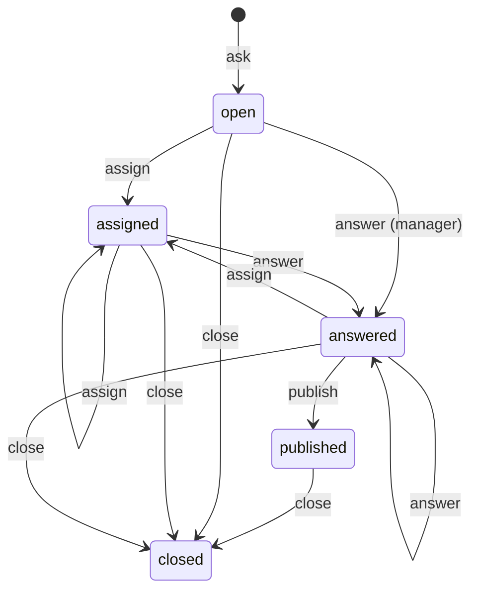

During due diligence, buyers send the seller hundreds of questions: how is deferred revenue treated, is this lease
assignable, where are the board minutes for 2023. The sell side has to route each question to the person who knows
the answer, check the answer before it goes out, and decide whether every bidder may see it or only the one who asked.
Bidders compete with each other, so one bidder must never learn what another asked.

The Q&A plugin runs that workflow inside a room. Participants ask, managers assign questions to experts, experts draft
answers, and managers approve and publish them, either to the asking team or to the whole room without the asker's
name.

```ts
import { betterFiles } from 'better-files';
import { betterFilesIamPlugin } from 'better-files/iam';
import { qaPlugin } from 'better-files/plugin-qa';

const plugins = [qaPlugin({ maxOpenPerGroup: 50 })] as const;
const iamPlugin = betterFilesIamPlugin({ plugins }); // registers the better-files:qa:* actions

export const dr = betterFiles({ /* iam, database, storage, secret */ plugins });

// A bidder asks about a document.
const question = await dr.api.qa.ask(bidder, {
  tenantId,
  roomId,
  subject: 'Revenue recognition',
  text: 'How is deferred revenue treated?',
  nodeId: documentId,
  priority: 'high',
});

// The deal lead assigns it, the expert answers, the deal lead publishes.
await dr.api.qa.assign(dealLead, { tenantId, questionId: question.id, assigneeId: cfoIdentityId });
await dr.api.qa.answer(cfo, { tenantId, questionId: question.id, answer: 'Over the service period.' });
await dr.api.qa.publish(dealLead, { tenantId, questionId: question.id, visibility: 'room' });
```

The plugin owns one table, `questions`. On a SQL database, run `better-files generate` and `better-files migrate`
after adding it.

## Options

<TypeTable
  type={{
    maxOpenPerGroup: {
      type: 'number',
      description: 'How many questions one team may have open, assigned or answered (not yet published or closed) at once. Asking beyond it fails with QUOTA_EXCEEDED. Applies only to askers who belong to at least one permission group of the room.',
      default: 'unlimited',
    },
    categories: {
      type: 'readonly string[]',
      description: 'The allowed values of category. When set, ask refuses any other category with INVALID_INPUT. A question without a category is always accepted.',
    },
  }}
/>

## Roles

The plugin adds three Better IAM actions and grants them to room relations:

| Action | Granted to | What it allows |
| --- | --- | --- |
| `better-files:qa:ask` | `owner`, `admin`, `publisher`, `editor`, `contributor`, `viewer` | Ask questions and list the ones you may see |
| `better-files:qa:answer` | `owner`, `admin`, `publisher`, `editor` | Draft answers to questions assigned to you |
| `better-files:qa:manage` | `owner`, `admin`, `publisher` | See every question, assign, answer any, publish and close |

Each caller gets one role per request, from the strongest action Better IAM allows them on the room:

- A **manager** holds `better-files:qa:manage`.
- An **expert** holds `better-files:qa:answer` but not `manage`.
- A **participant** holds neither.

The `auditor` relation gets none of these actions, so auditors cannot list questions.

## Teams

A participant's **team** is the set of the room's permission groups they belong to (a permission group is a room
group, such as "Bidder A", backed by a Better IAM group). When someone asks, the question stores the ids of their
groups at that moment as `groupIds`. Everyone in any of those groups sees the question, its status and, once
published, its answer. Later group changes do not move existing questions.

## Lifecycle



- `assign` works on any question that is not `published` or `closed`, so a manager can reassign at any point before
  publishing.
- `answer` replaces the draft and clears any earlier approval. A published or closed question cannot be answered
  again.
- `publish` needs an `answered` question.
- `close` works from any status, including on a closed room.

## Endpoints

Each endpoint is on `dr.api.qa` on the server, and on the browser client as `client.qa.<name>(input)` without the
credential. All inputs also take `tenantId`.

### ask

`dr.api.qa.ask(credential, input)` needs `better-files:qa:ask` on the room.

<TypeTable
  type={{
    roomId: { type: 'string', description: 'The room.', required: true },
    subject: { type: 'string', description: '1 to 200 characters, trimmed.', required: true },
    text: { type: 'string', description: 'The question, 1 to 10,000 characters.', required: true },
    nodeId: {
      type: 'string',
      description: 'A document or folder the question is about. The asker must hold LIST on it; otherwise the call fails with NOT_FOUND, as if it did not exist.',
    },
    category: { type: 'string', description: 'Up to 64 characters; one of options.categories when set.' },
    priority: { type: "'low' | 'normal' | 'high'", description: 'How urgent the question is.', default: "'normal'" },
  }}
/>

It returns the new question with status `open`, visibility `group`, and the asker's `askedBy`, `askerName` (when
Better IAM knows a name) and `groupIds`.

### list

`dr.api.qa.list(credential, { tenantId, roomId, status?, assignedToMe? })` needs `better-files:qa:ask` and works on
closed rooms too. It returns up to 1,000 questions, newest first, filtered to what the caller may see (next section).
`status` narrows to one status; `assignedToMe: true` narrows to questions assigned to the caller.

### assign

`dr.api.qa.assign(credential, { tenantId, questionId, assigneeId, dueAt? })` needs `better-files:qa:manage`. It sets
the status to `assigned` and records `assignedTo`. `dueAt` is a time in epoch milliseconds; leaving it out keeps any
earlier due date. The plugin does not check that the assignee is a member of the room, and nothing happens
automatically when `dueAt` passes.

### answer

`dr.api.qa.answer(credential, { tenantId, questionId, answer })` needs `better-files:qa:answer`. The answer is 1 to
20,000 characters. An expert may answer only questions assigned to them; anyone else gets `FORBIDDEN`. Managers may
answer any question. The status becomes `answered` and `answeredBy` records who wrote it.

### publish

`dr.api.qa.publish(credential, { tenantId, questionId, visibility? })` needs `better-files:qa:manage`. It records the
manager as `approvedBy`, sets `publishedAt`, and makes the answer visible:

- `visibility: 'group'` (the default for a new question) shows it to the asking team only.
- `visibility: 'room'` shows it to everyone in the room, without who asked.

Leaving `visibility` out keeps the question's current value.

### close

`dr.api.qa.close(credential, { tenantId, questionId, reason? })` needs `better-files:qa:manage`. `reason` (up to 500
characters) is kept in the activity log only. It returns `{ closed: true }`.

## Who sees what

`list` applies these rules to every question:

| Caller | Sees the question when | Sees |
| --- | --- | --- |
| Manager | always | everything, including drafts, `assignedTo`, `answeredBy` and `approvedBy` |
| Expert | it is assigned to them | everything |
| Asker or their team | always | the question and its status; the answer only once published |
| Anyone else | it is published with `visibility: 'room'` | the question and answer, without `askedBy`, `askerName` and `groupIds` |

Outside the first two rows, `answeredBy`, `approvedBy` and `assignedTo` are always removed, and so is `answer` until
the question is published. In the test suite, a second bidder's list stays empty while the first bidder's question is
open, and after a room-wide publish the second bidder sees the subject and answer but not who asked.

<Callout type="warn" title="Anonymized questions keep their document reference">
  A room-wide published question still carries its `nodeId`, so other teams learn which document it was about, even
  one they cannot see. Avoid `visibility: 'room'` for questions that point at documents only some teams may see, or
  publish them to the asking team only.
</Callout>

## Events and activity

Each step appends to the room's activity log and emits an event to `dr.events` subscribers, plugin `onEvent` hooks
and webhooks once the transaction commits. Activity records never hold the question text or the answer.

| Step | Activity metadata | Event payload |
| --- | --- | --- |
| `qa.asked` | `questionId`, `subject` (and the record's `nodeId`) | `questionId`, `subject`, `priority` |
| `qa.assigned` | `questionId`, `assigneeId` | `questionId`, `assigneeId`, `dueAt` |
| `qa.answered` | `questionId` | `questionId` |
| `qa.published` | `questionId`, `visibility` | `questionId`, `visibility`, `groupIds` |
| `qa.closed` | `questionId`, `reason` | `questionId` |

The [notifications plugin](/docs/plugins/notifications) emails the assignee on `qa.assigned`. To tell the asking team
when an answer is published, subscribe to `qa.published` and use its `groupIds`.

## In the browser

The typed client exposes the same endpoints. With the React bindings, read through `useQuery` and write through
`useAction`:

```tsx
const questions = useQuery(`qa:${roomId}`, (client) => client.qa.list({ roomId }));

const ask = useAction(
  (client, subject: string, text: string) => client.qa.ask({ roomId, subject, text }),
  'qa:',
);
```

The MCP server in `better-files/mcp` also offers `list_questions`, and with write tools enabled `ask_question` and
`answer_question`, when the Q&A plugin is installed.

## Room state and NDAs

`ask`, `assign`, `answer` and `publish` change the room, so they fail with `ROOM_CLOSED` in a closed or archived room.
`list` and `close` still work there. With the [NDA plugin](/docs/plugins/nda), every Q&A operation is refused until the
caller has accepted the room's NDA.

## Errors

| Code | When |
| --- | --- |
| `INVALID_INPUT` | Input fails validation, or `category` is not one of `options.categories`. |
| `NOT_FOUND` | The question does not exist in the tenant, or `nodeId` names something the asker cannot list. |
| `FORBIDDEN` | Better IAM refuses the action, or an expert answers a question assigned to someone else. |
| `CONFLICT` | Assigning or answering a published or closed question, or publishing one that is not `answered`. |
| `QUOTA_EXCEEDED` | The asker's team already has `maxOpenPerGroup` unpublished questions. |
| `ROOM_CLOSED` | A mutating call other than `close` on a closed or archived room. |

See [errors](/docs/reference/errors) for status codes.

## Limits

- Subjects 200 characters, questions 10,000, answers 20,000, categories 64, close reasons 500.
- `list` returns at most the 1,000 newest matching questions, before visibility filtering.
- Questions are never deleted by the plugin; `close` keeps them with `closedAt`.

## Related

- [Notifications](/docs/plugins/notifications): emails assignees when a question is assigned.
- [Tasks](/docs/plugins/tasks): checklists for the rest of the deal process.
- [Webhooks](/docs/plugins/webhooks): forward `qa.*` events to other systems.
- [NDA gating](/docs/plugins/nda): Q&A stays closed until the NDA is accepted.
- [Better IAM integration](/docs/guides/better-iam): how the `better-files:qa:*` actions reach Better IAM.
