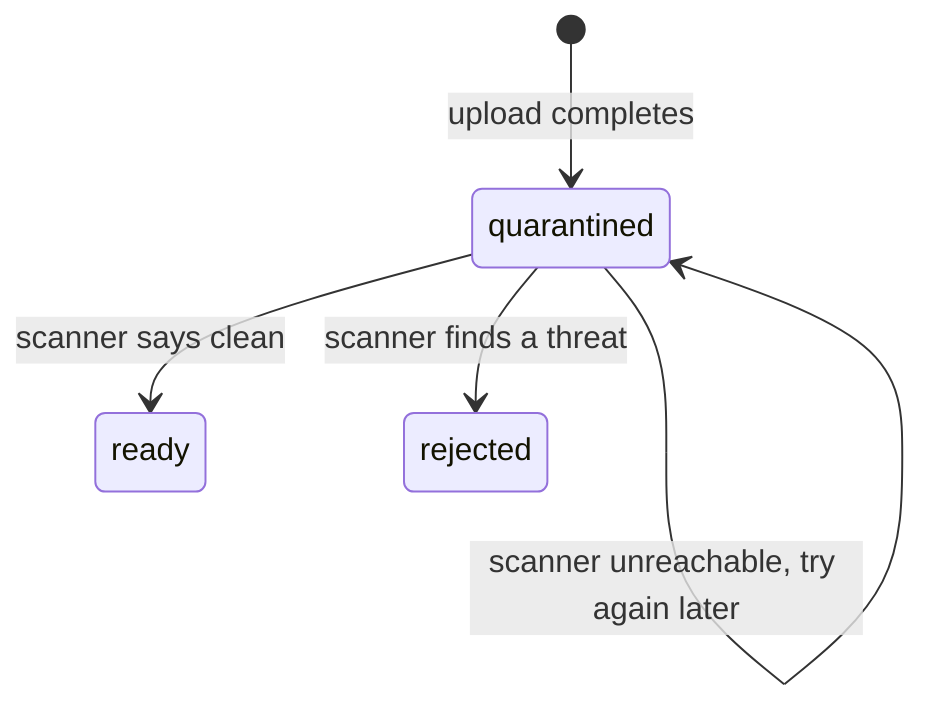

A data room takes files from people outside your organization: sellers, buyers, advisers, their assistants. One
infected spreadsheet uploaded by a counterparty should not reach everyone else in the room. Security teams usually
ask that nothing uploaded can be opened until an antivirus engine has looked at it.

The scanning plugin does that. Each new version is **quarantined** (stored, but nobody can view or download it) until
the scanner reports it clean. Meanwhile the document keeps serving its previous clean version. An infected version is
**rejected**: its bytes are deleted from storage and a `document.threat-detected` event is published.

```ts
import { betterFiles } from 'better-files';
import { clamavScanner, scanningPlugin } from 'better-files/plugin-scan';

const plugins = [
  scanningPlugin({ scanner: clamavScanner({ host: 'clamav', port: 3310 }) }),
] as const;

export const dr = betterFiles({ /* iam, database, storage, secret */ plugins });
```

The plugin adds no actions and no endpoints, so it needs nothing from Better IAM. Passing it to
`betterFilesIamPlugin({ plugins })` along with your other plugins is harmless.

## What happens to an upload



1. When an upload completes, the plugin's `afterUpload` hook marks the new version `quarantined`. The document's
   current version goes back to the newest `ready` version, or to none if this is the first version.
2. The scanner reads the stored content as a stream. Nothing is written to disk by the ClamAV client.
3. **Clean:** the version becomes `ready`. It becomes the document's current version, unless a newer version was
   uploaded in the meantime. The plugin publishes `version.scanned`.
4. **Infected:** the version becomes `rejected`. Its stored bytes are deleted (unless `deleteInfected: false`); the
   version record stays. The plugin publishes `document.threat-detected`.

Only a version that is still `quarantined` takes a verdict. If two scans of the same version overlap (a retried job
and `dr.maintain()`, for example), the second changes nothing and publishes nothing.

While a version is quarantined, people see this:

- The upload response reports `version.status: 'quarantined'`, even in `inline` mode, where the scan has finished by
  the time the call returns.
- Asking for the quarantined version by id (`documents.requestOriginal` with `versionId`, and the other download and
  view requests) fails with `QUARANTINED` (HTTP 409).
- Asking for the document without a version id serves the previous clean version. A document whose only version is
  quarantined has no current version yet, and the request fails with `CONFLICT`.
- A rejected version also fails with `CONFLICT`.

## Options

`scanningPlugin(options)` takes:

<TypeTable
  type={{
    scanner: {
      type: 'Scanner',
      description: 'What scans the bytes: clamavScanner(), or your own (see Use another scanner).',
      required: true,
    },
    mode: {
      type: "'background' | 'inline'",
      description: 'background: the upload completes as quarantined and the scan runs as a durable job. inline: the upload request waits for the verdict.',
      default: "'background'",
    },
    deleteInfected: {
      type: 'boolean',
      description: 'Delete the stored bytes of infected versions. The version record stays, marked rejected.',
      default: 'true',
    },
    retryAfterMs: {
      type: 'number',
      description: 'Versions still quarantined after this long are scanned again by dr.maintain().',
      default: '600000 (10 minutes)',
    },
  }}
/>

`clamavScanner(options)` takes:

<TypeTable
  type={{
    host: { type: 'string', description: 'Host where clamd listens.', default: "'127.0.0.1'" },
    port: { type: 'number', description: 'TCP port of clamd.', default: '3310' },
    timeoutMs: {
      type: 'number',
      description: 'Milliseconds of socket inactivity before a scan gives up.',
      default: '120000',
    },
  }}
/>

### Background or inline

In `background` mode (the default), the upload enqueues a `scanning.scan` job in the same transaction as the upload,
keyed by the version id. The job runs on `dr.jobs`' runner, up to 8 attempts, with backoff between them. A crash or
a scanner outage only delays the verdict. You can see the job like any other:

```ts
const jobs = await dr.jobs.list(tenantId, { name: 'scanning.scan' });
// [{ status: 'pending', attempts: 1, lastError: 'scanner unreachable', payload: { versionId }, ... }]
```

In `inline` mode, the scan runs after the upload commits but before the upload request answers. If the scanner fails,
the error is logged (`Virus scan failed`) and the version stays quarantined until `dr.maintain()` tries again. Inline
mode makes uploads slower, and a slow scanner holds the request open.

## Maintenance

`dr.maintain()` looks for versions that have been quarantined for longer than `retryAfterMs` and scans them again,
up to 50 per run, in both modes. This catches versions whose job used up its attempts, and inline scans that failed.
Schedule `dr.maintain()` every few minutes.

## Run ClamAV

`clamavScanner()` speaks clamd's `INSTREAM` protocol over TCP. Any clamd works; the `clamav/clamav` container image
listens on port 3310, for example with `docker run -d -p 3310:3310 clamav/clamav`. In production, run clamd next to
your application on a private network: the protocol has no authentication.

<Callout type="warn" title="Large files">
  clamd refuses streams larger than its `StreamMaxLength` setting. The client reports that answer as a scanner
  failure, so such a file stays quarantined and is retried. Set `StreamMaxLength` (and `MaxFileSize`, `MaxScanSize`)
  in `clamd.conf` at least as high as your largest upload.
</Callout>

The client maps clamd's answers like this:

- `...: OK` is clean.
- `...: <signature> FOUND` is infected, with the signature name as `threat`.
- Anything else, a connection error, or a timeout throws `BetterFilesError` with code `INTERNAL_ERROR` and a message
  starting with `The virus scanner failed`, `The virus scanner is unreachable` or `The virus scanner timed out`.

## Use another scanner

A scanner is any object with an `id` and a `scan` method that reads a stream and answers `{ clean, threat? }`. Throw
when you cannot decide; the version stays quarantined and is tried again.

```ts
import { scanningPlugin, type Scanner } from 'better-files/plugin-scan';

const cloudScanner: Scanner = {
  id: 'cloud',
  async scan(content) {
    const response = await fetch('https://scanner.internal/scan', {
      method: 'POST',
      body: content,
      duplex: 'half',
    } as RequestInit);
    if (!response.ok) throw new Error(`Scanner answered ${response.status}`);
    const { infected, signature } = (await response.json()) as { infected: boolean; signature?: string };
    return infected ? { clean: false, threat: signature ?? 'unknown' } : { clean: true };
  },
};

scanningPlugin({ scanner: cloudScanner });
```

## Events

The plugin publishes events on `dr.events` (and so to webhooks). It writes nothing to the room's activity log.

| Event | Data | When |
| --- | --- | --- |
| `version.scanned` | `nodeId`, `versionId` | A quarantined version was found clean. |
| `document.threat-detected` | `nodeId`, `versionId`, `threat`, `filename` | A version was found infected. `threat` is `'unknown'` when the scanner gave no name. |

```ts
dr.events.subscribe('document.threat-detected', (event) => {
  securityTeam.alert(`Malware ${event.data.threat} in ${event.data.filename} (room ${event.roomId})`);
});
```

## Limits

- Every completed upload is scanned, new documents and new versions alike. The scanner reads the whole file.
- Background scans retry 8 times as a job; after that, only `dr.maintain()` retries, every `retryAfterMs`.
- `dr.maintain()` rescans at most 50 stale versions per run.
- With `deleteInfected: false`, rejected bytes stay in storage, but Better Files never serves a rejected version.

## Related

- [Download guard](/docs/plugins/guard): stops bulk downloads.
- [Document processing](/docs/plugins/processing)
- [Webhooks](/docs/plugins/webhooks): forward `document.threat-detected` to your alerting.
- [Error codes](/docs/reference/errors)
